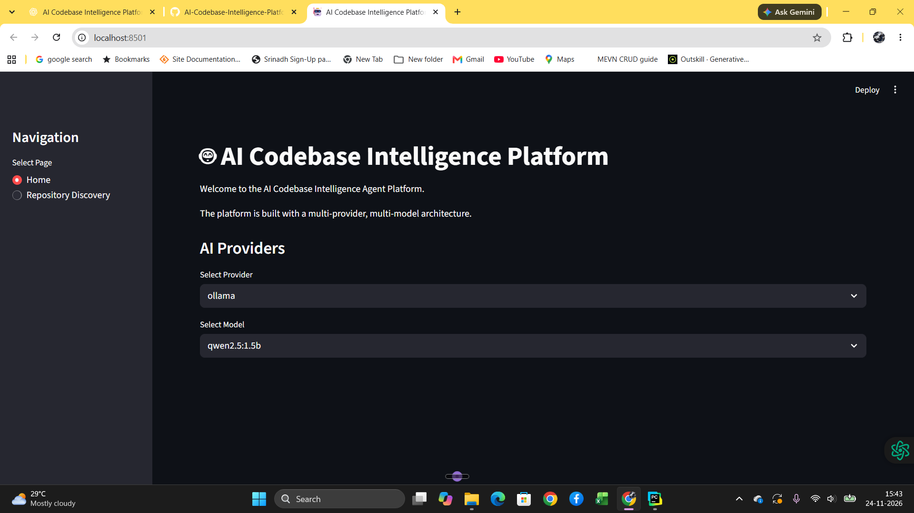
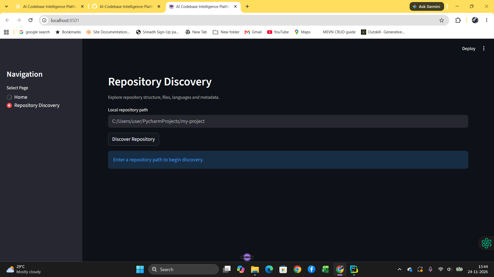
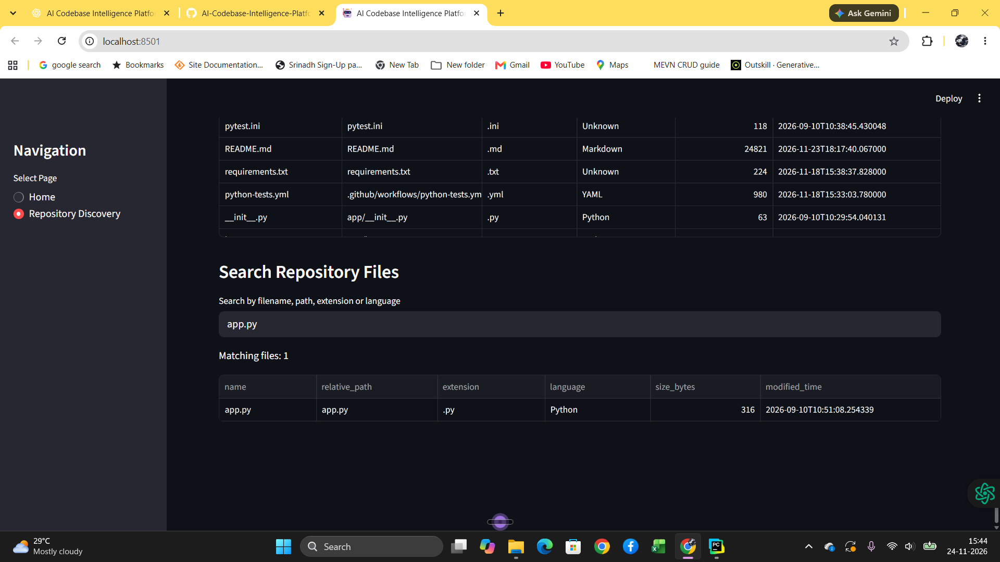
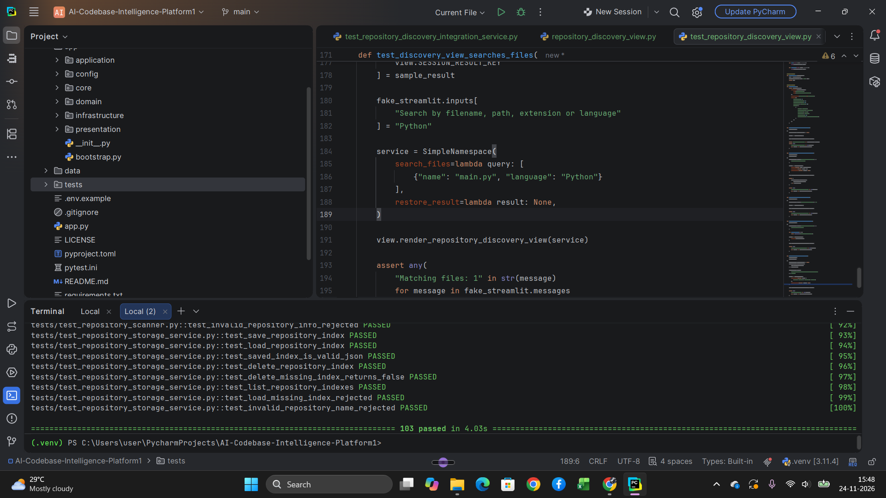
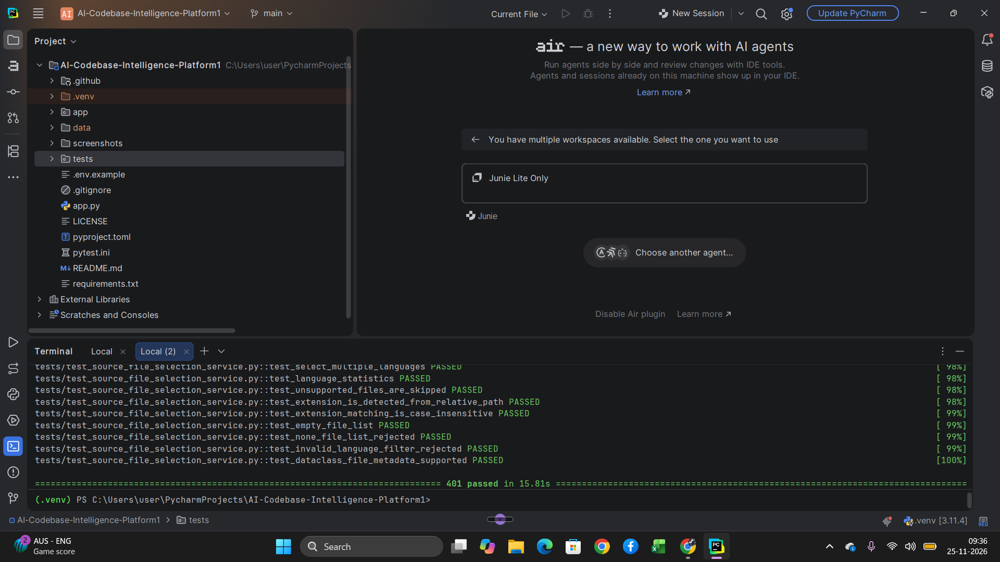
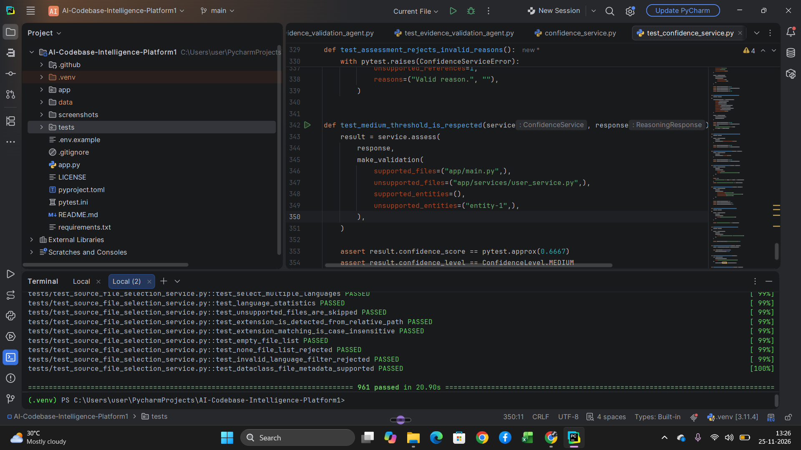

# Screenshots Documentation

This document provides an overview of the screenshots captured for the **AI Codebase Intelligence Platform**. These images demonstrate the application's interface, repository-related workflows, and phase-wise test reports.

## Screenshot Directory

All screenshots are stored in the project's `screenshots/` directory.

```text
screenshots/
├── homepage
├── phase1tests-report
├── phase2tests-report
├── phase3tests-report
├── phase4tests-report
├── repodetails output
├── repooutputput
├── repository
└── searchfilerepo
```

## Application Screenshots

### 1. Homepage

The main application interface.



### 2. Repository Details Output

Screenshot showing repository details output.


### 3. Repository Output

Screenshot showing repository-related output.


### 4. Repository View

Screenshot of the repository interface.



### 5. Repository File Search

Screenshot showing the repository file-search interface.



## Phase-wise Test Reports

The following screenshots capture the test reports for the project's development phases.

### 6. Phase 1 Test Report



### 7. Phase 2 Test Report



### 8. Phase 3 Test Report



### 9. Phase 4 Test Report


## Notes

- Keep all screenshot files inside the root-level `screenshots/` directory.
- The image references in this document use relative paths.
- If a screenshot is renamed or its file extension changes, update the corresponding Markdown image reference.
- These screenshots serve as visual documentation of the completed project.

**Project Status:** Completed